# STAR Master

STAR Master is a web application designed to help job seekers prepare for behavioral interview questions using the STAR (Situation, Task, Action, Result) method. The platform provides a structured approach to crafting responses, allowing users to create, edit, and review their STAR stories. Users can also craft basic text responses without the STAR structure if they prefer.

The application features a library of public questions that serve as examples and inspiration, alongside private questions where users can build their personal interview preparation toolkit. With an intuitive interface built using Django and styled with Tailwind CSS and DaisyUI, STAR Master makes interview preparation organized and effective.

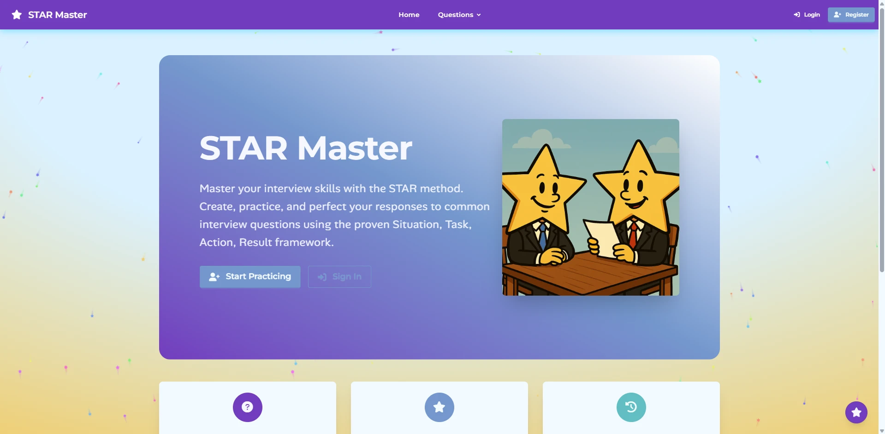

## Contents 

- [STAR Master](#star-master)
  - [Contents](#contents)
  - [Project Overview](#project-overview)
  - [User Experience Design (UI/UX)](#user-experience-design-uiux)
  - [Database](#database)
  - [CRUD Functionality and Authentication/Authorization](#crud-functionality-and-authenticationauthorization)
  - [Agile Methodology](#agile-methodology)
  - [Testing and Validation](#testing-and-validation)
  - [Use of AI](#use-of-ai)
  - [Development](#development)
  - [Deployment](#deployment)
  - [Credits](#credits)

## Project Overview

<details>
   <summary>View project overview</summary>
   <br />
   
   This website aims to address a common challenge faced by job seekers: effectively preparing for behavioral interview questions. The STAR method (Situation, Task, Action, Result) is a proven framework for structuring compelling interview responses, but keeping track of a lifetime of STAR stories and practicing them can be challenging.
   
   This application provides:
   
   - **Personal Question Library**: Users can create and manage their own private interview questions and answers
   - **Public Question Repository**: A community-driven collection of common interview questions that users can reference and copy to their own library
   - **Flexible Answer Formats**: Support for both structured STAR answers and free-form basic text answers
   - **Tag-Based Organization**: Custom tagging system to categorize questions by topic, skill, or any other criteria
   - **Responsive Design**: Fully responsive interface that works seamlessly on desktop, tablet, and mobile devices
   - **Secure Authentication**: User registration and login system with role-based permissions
   
   ### Technologies Used
   
   #### Backend
   - **[Django](https://www.djangoproject.com/)** - High-level Python web framework
   - **[Django Allauth](https://django-allauth.readthedocs.io/)** - Authentication, registration, and account management
   - **[PostgreSQL](https://www.postgresql.org/)** - Advanced open-source relational database
   - **[NeonDB](https://neon.tech/)** - Serverless PostgreSQL database platform for cloud deployment
   - **[Gunicorn](https://gunicorn.org/)** - Python WSGI HTTP server for production deployment
   
   #### Frontend
   - **[Tailwind CSS](https://tailwindcss.com/)** - Utility-first CSS framework
   - **[DaisyUI](https://daisyui.com/)** - Tailwind CSS component library
   - **[Django Tailwind](https://django-tailwind.readthedocs.io/)** - Tailwind CSS integration for Django
   
   #### Development Tools
   - **[pytest](https://pytest.org/)** - Testing framework for Python
   - **[pytest-django](https://pytest-django.readthedocs.io/)** - Django plugin for pytest
   - **[pytest-xdist](https://pytest-xdist.readthedocs.io/)** - Parallel test execution for pytest
   - **[Flake8](https://flake8.pycqa.org/)** - Python code linting tool
   - **[Black](https://black.readthedocs.io/)** - Python code formatter
   - **[Django Debug Toolbar](https://django-debug-toolbar.readthedocs.io/)** - Debugging panel for Django development
   
   #### Deployment
   - **[Heroku](https://www.heroku.com/)** - Cloud platform for deploying and managing web applications
   - **[WhiteNoise](http://whitenoise.evans.io/)** - Static file serving for Python web apps
   - **[dj-database-url](https://github.com/jazzband/dj-database-url)** - Database configuration via URL
</details>

## User Experience Design (UI/UX)
<details>
   <summary>View UI/UX design details</summary>
   <br />
   
   ### Front-End Design
   
   #### Colour Scheme
   
   The colour theme was finalised later on in the design process, after the main functionality and layout were established. To help with this process, I asked AI to build me a theme-testing page (only accessible in debug mode) that included colour pickers to allow me to quickly experiment with different colour combinations. The page includes a list of common UI elements, such as buttons and cards. This allowed me to quickly experiment with different colour combinations and see how they looked in the context of the application.
   
   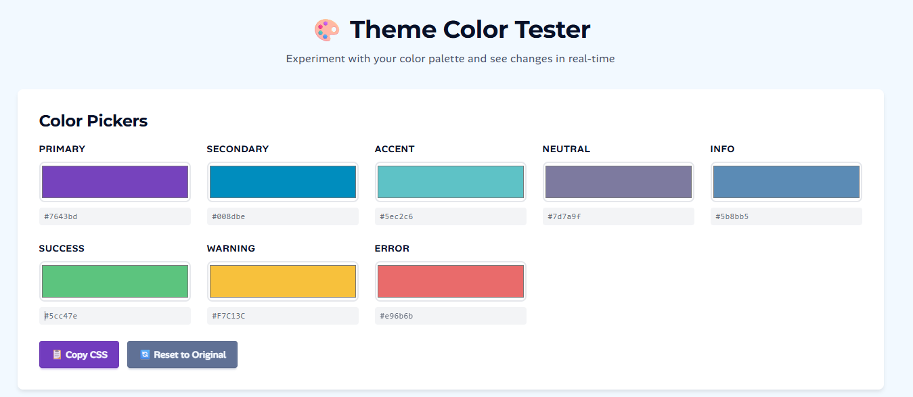
   
   #### Typography
   
   **Montserrat** was chosen for headings, providing a modern, bold appearance that draws attention to key sections and navigation elements. **Alan Sans** was used for body text, chosen to add a subtle contrast to the main font while being similar enough to common sans-serif fonts.
   
   To enhance readability further, small adjustments were made to letter spacing and line height of body text. These subtle details made a small but notable difference in overall legibility.
   
   Both fonts are sourced from Google Fonts, ensuring fast loading times and consistent rendering across different devices and browsers.
   
   #### Wireframes
   
   Wireframes were worked on iteratively throughout the design process, starting out with minimal sketches and gradually evolving into more detailed designs as the project progressed. The wireframes were created using Balsamiq, which allowed for quick adjustments and refinements.
   
   Pages within the project that had more complex layouts were wireframed for both mobile and desktop views to plan out the responsive design. Other pages that were more simple in layout were only wireframed in one view, as the layout was similar across all device sizes. Beyond the MVP, additional views for desktop could be created to further enhance the experience on larger screens.
   
   **Wireframe Screenshots:**
   
   <details>
   <summary>Click to view wireframes</summary>
   
   **Home Page**
   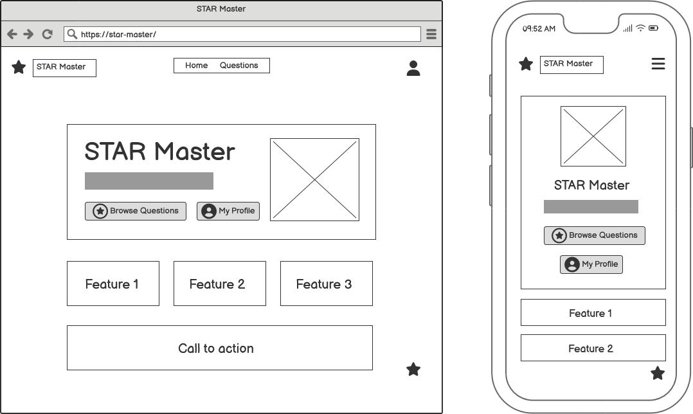
   
   **Sign Up**
   
   
   **Log In**
   
   
   **Profile**
   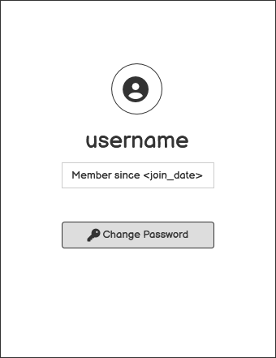
   
   **Questions List**
   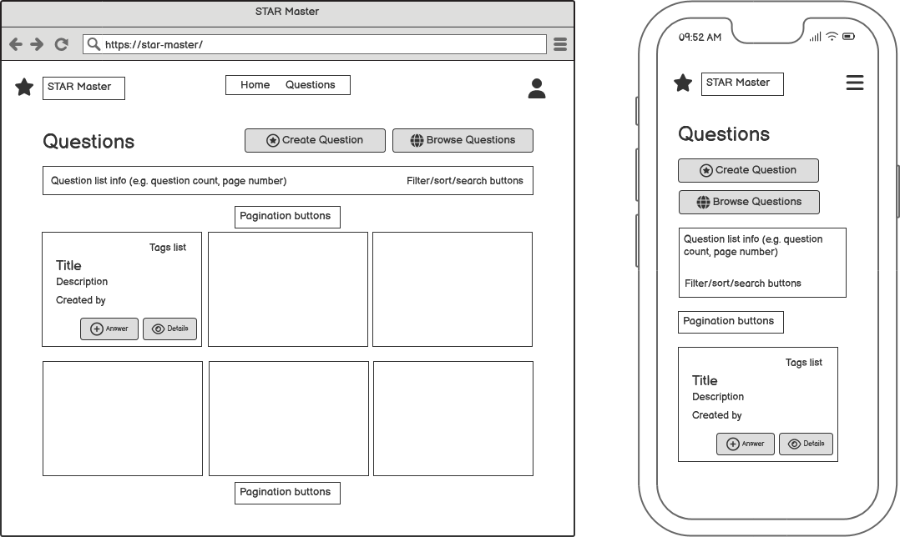
   
   **Question Detail**
   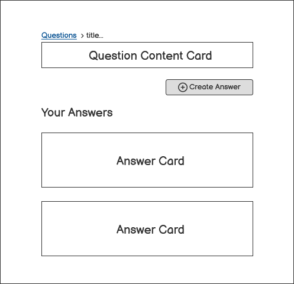
   
   **Create Question**
   
   
   **Edit Question**
   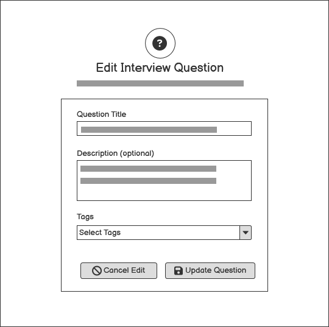
   
   **Create Answer**
   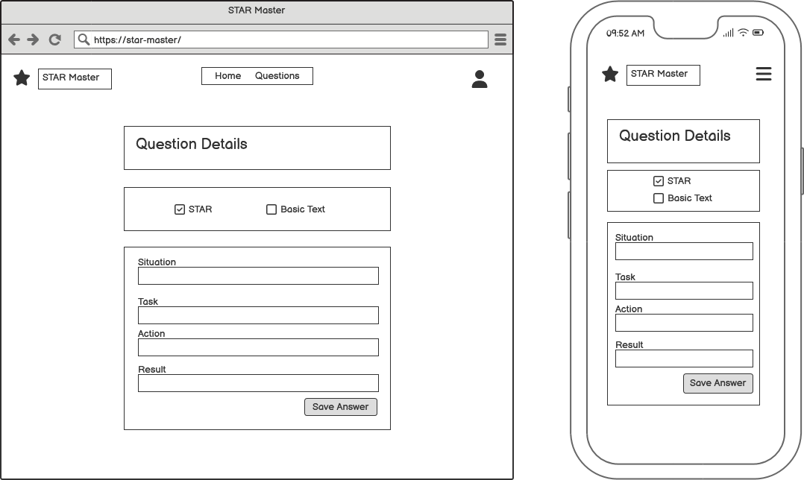
   
   **Edit Answer**
   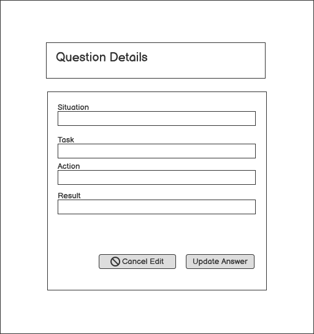
   
   **Change Password**
   
   
   **404 Error Page**
   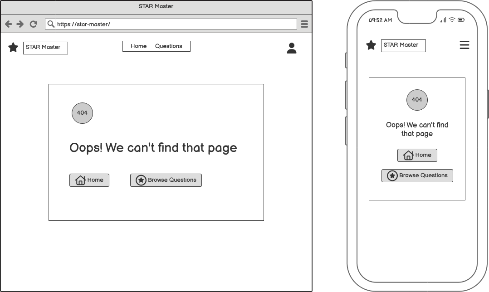
   
   </details>
   
   #### Responsive Design
   
   Using Tailwind CSS's thoughtfully designed utility-first system, the application achieves full responsiveness across all device sizes. Tailwind's predefined breakpoints (`sm`, `md`, `lg`, `xl`) allowed for rapid development of adaptive layouts without writing custom CSS media queries.
   
   Key responsive design decisions:
   
   - **Mobile-First Approach**: Base styles target mobile devices, with enhancements added for larger screens
   - **Flexible Grid Systems**: Tailwind's grid and flexbox utilities create layouts that adapt smoothly to different screen sizes
   - **Component Consistency**: DaisyUI components maintain visual consistency while adapting to different viewports
   - **Simplified Authentication Pages**: Login and registration pages use minimal layouts to ensure excellent usability across all devices, allowing focus on the more complex main application pages
   
   The combination of Tailwind CSS and DaisyUI enabled rapid prototyping while maintaining high-quality, production-ready responsive designs.
   
   ### User Experience Design
   
   #### Navigation Structure
   
   The application features a clear, hierarchical navigation system:
   
   **Site Map:**
   
   
   The navigation adapts based on user authentication state:
   - **Unauthenticated users**: See links to home, public questions, login, and signup
   - **Authenticated users**: Access to their profile, private questions, and logout functionality
   - **Admin users**: Additional link to the Django admin panel for managing public questions and users
   
   
   #### Usability Considerations
   
   - **Consistent Layout**: All pages follow a predictable structure with header, main content area, and clear calls-to-action
   - **Intuitive Forms**: Form fields include helpful placeholder text and validation messages
   - **Visual Feedback**: Success messages, error alerts, and loading states keep users informed
   - **Clear Action Hierarchy**: Primary actions use prominent styling, while secondary actions are visually subdued
   - **Accessibility**: Semantic HTML, ARIA labels, and keyboard navigation support ensure the application is usable by all
   
   ### Accessibility
   
   I used https://www.accessibilitychecker.org/ to check key pages in deployment for accessibility issues.
   I also used IBM Equal Access Accessibility Checker and in development to also catch issues in chrome devtools for authenticated pages. In the command line, I used Pa11y as an addional check.
   
   ```console
   Welcome to Pa11y
   
    > Running Pa11y on URL http://localhost:8000
   
   No issues found!
   ```
</details>

## Database
<details>
   <summary>View database details</summary>
   <br />
   
   ### Database Structure and Models
   
   #### Key Models
   
   The application is built on a well-structured database schema with the following core models:
   
   - **User** - Built-in Django model extended by Django Allauth for authentication and profile management
   - **Question** - Represents an interview question, which can be either public (shared with the community) or private (personal use only)
   - **Tag** - Represents keywords or categories for organizing questions. Tags can be public (available to all users) or private (user-specific)
   - **Answer** - Represents a user's response to a question, with two distinct subtypes:
     - **BasicAnswer** - A simple text-based response for users who prefer free-form answers
     - **StarAnswer** - A structured response following the STAR methodology with separate fields for Situation, Task, Action, and Result
   
   #### Model Relationships
   
   The database structure implements the following relationships:
   
   - **User → Questions**: One-to-many relationship (a user can create multiple questions)
   - **Question → Tags**: Many-to-many relationship (questions can have multiple tags, tags can be associated with multiple questions)
   - **User → Answers**: One-to-many relationship (a user can create multiple answers)
   - **Question → Answers**: One-to-many relationship (a single question can have multiple answers)
   
   #### Entity Relationship Diagram (ERD)
   
   The following ERD visualizes the database structure, showing all fields and relationships. Django automatically creates database tables based on these model definitions and handles relationships through foreign keys and many-to-many intermediate tables.
   
   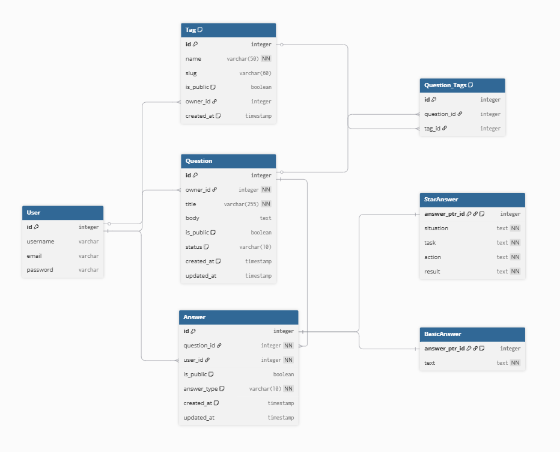
</details>

## CRUD Functionality and Authentication/Authorization
<details>
   <summary>View CRUD functionality details</summary>
   <br />
   
   The application provides comprehensive Create, Read, Update, and Delete operations for managing interview questions and answers, with business rules enforced at multiple levels.
   
   #### Questions
   
   **Create:**
   - Authenticated users can create both private and public questions
   - Private questions are automatically approved and immediately available to the user
   - Public questions submitted by regular users are marked as "Pending" and require admin approval before appearing in the public library
   - Admin users can create public questions that are automatically approved
   
   **Read:**
   - Users can view all their own questions (both private and public)
   - All users (including unauthenticated visitors) can browse approved public questions
   - Only admins can view pending public questions from other users
   
   **Update:**
   - Users can edit their own questions at any time
   - Editing a public question that was previously approved changes its status back to "Pending" for re-approval (unless the editor is an admin)
   - Tags can be added or removed during editing
   
   **Delete:**
   - Users can delete their own private questions and any associated answers
   - Public questions can only be deleted by admins or the question owner
   - Deleting a question cascades to delete all associated answers
   
   #### Answers
   
   **Create:**
   - Users can create answers only for questions they have access to (their own questions or approved public questions)
   - Users choose between STAR format or basic text format when creating an answer
   - Each field in a STAR answer is required and validated on submission
   
   **Read:**
   - Users can view all their own answers
   - Answers are displayed within the context of their associated question
   - Public answers on approved public questions are visible to all users
   
   **Update:**
   - Users can edit their own answers at any time
   - The answer format (STAR vs Basic) is preserved during editing
   
   **Delete:**
   - Users can delete their own answers
   - Deleting a question automatically deletes all associated answers (cascade delete)
   
   ### User Notifications
   
   The application provides real-time feedback to users for all significant actions:
   
   - **Success Messages**: Displayed when questions or answers are created, updated, or deleted
   - **Error Messages**: Show validation errors or permission issues
   - **Info Messages**: Provide context about pending approvals or status changes
   - **Django Messages Framework**: All notifications use Django's built-in messages framework with DaisyUI alert styling
   
   Examples:
   - "Question created successfully and submitted for approval"
   - "Your answer has been saved"
   
   ### Authentication and Authorization
   
   #### Role-Based Access Control
   
   The application implements a two-tier permission system:
   
   **Regular Users:**
   - Create and manage private questions and answers
   - View approved public questions
   - Submit public questions for admin review
   - Create private tags for personal organization
   
   **Admin Users:**
   - All regular user permissions
   - Approve or deny pending public questions
   - Access Django admin panel for user and content management
   - Create public tags available to all users
   - Edit or delete any content
   
   #### Login State Reflection
   
   The navigation bar adapts based on the user's authentication state: logged-out users see Login and Sign Up links and can browse public questions; logged-in regular users see their username, links to Profile, My Questions, and Logout, with a clear indicator of their login status; admin users have all regular user options plus an "Admin Panel" link and a visual badge indicating admin privileges.
   
   #### Access Control Implementation
   
   Security is enforced at multiple levels:
   
   1. **View-Level Protection**: Django's `LoginRequiredMixin` and custom permission checks prevent unauthorized access
   2. **Model-Level Filtering**: QuerySets filter data based on user ownership and permissions
   3. **Template-Level Conditionals**: UI elements only display actions the user is permitted to perform
   4. **Form-Level Validation**: Server-side validation ensures users cannot manipulate data they don't own
   
   Example security implementations:
   - URL manipulation cannot expose other users' private questions
   - CSRF protection on all forms prevents cross-site request forgery
   - Session management ensures secure authentication state
   
   ### Additional Features
   
   #### Search, Sort and Filter
   - Full-text search across question titles, question descriptions, and answer content
   - Filter questions by tags
   - Separate views for private vs public questions
   - Sorting options (newest, oldest, A-Z, Z-A)
   
   #### Tag Management
   - Public tags created by admins are available to all users
   - Users can create private tags for personal organization
   - Case-insensitive tag handling prevents duplicates
   
   #### Performance Optimizations
   - Database query optimization using `select_related` and `prefetch_related`
   - Static file compression with WhiteNoise
   - Efficient pagination for large question lists
</details>

## Agile Methodology
<details>
   <summary>View Agile methodology details</summary>
   <br />
   
   Agile methodology enabled iterative development, continuous feedback, and adaptive planning throughout the project lifecycle.
   
   ### Development Process
   
   The project was organized into small, iterative cycles (sprints) to allow for frequent reassessment and adaptation of plans. Using GitHub Projects, I maintained a backlog of tasks and user stories, which were reviewed at the beginning of each sprint. I estimated the effort required for each task and selected a reasonable number of tasks to complete within each sprint duration.
   
   This iterative approach allowed me to:
   - Respond quickly to technical challenges and changing requirements
   - Prioritize features based on user value
   - Maintain a sustainable development pace
   - Incorporate feedback and learning into subsequent sprints
   
   ### User Stories and MoSCoW Prioritization
   
   The project was broken down into manageable user stories, which were then prioritized using the MoSCoW method:
   
   - **Must Have**: Core functionality essential for the MVP (e.g., user authentication, question creation, STAR answer creation)
   - **Should Have**: Important features that significantly enhance user experience (e.g., tag system, public questions)
   - **Could Have**: Nice-to-have features that add value but aren't critical (e.g., advanced search filters, question voting)
   - **Won't Have**: Features explicitly excluded from the current scope (e.g., social sharing, mobile app)
   
   This prioritization ensured that the most important features were developed first and that the project stayed on track to deliver a functional product.
   
   Here is a screenshot of the GitHub Project board used to manage user stories and tasks:
   
   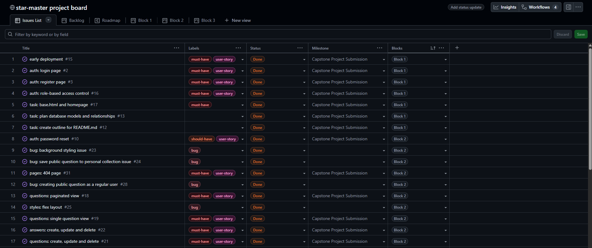
   
   ### Code Quality
   - **PEP 8 Compliance:** Code checked with Flake8 and formatted using Black for consistent style.
   - **Naming & Structure:** Models use singular CamelCase names; variables and functions use snake_case; code is organized by concerns with reusable components.
   - **Documentation:** Docstrings and comments added for clarity; file structure is logical and DRY principles are followed.
</details>

## Testing and Validation
<details>
   <summary>View testing and validation details</summary>
   <br />
   
   ### Automated Testing
   
   Here is a screenshot of the test results when running `pytest`:
   
   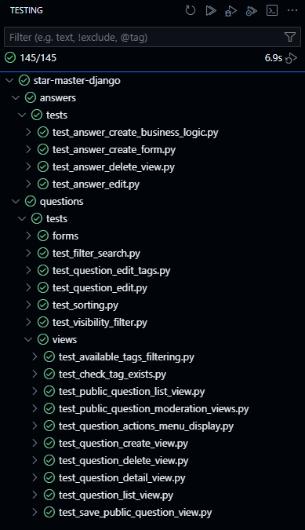
   
   #### Testing Strategy with Pytest
   
   The application uses **pytest** with **pytest-django** for comprehensive automated testing. The test suite covers models, views, forms, and business logic to ensure the application functions correctly and securely.
   
   **Test Organization:**
   Tests are organized in dedicated test directories within each app:
   ```
   questions/tests/
     views/
       test_question_list_view.py
       test_question_detail_view.py
       test_question_create_view.py
       test_question_edit_view.py
       test_question_delete_view.py
       test_save_public_question_view.py
     models/
     forms/
   
   answers/tests/
     [similar structure]
   ```
   
   **Running Tests:**
   ```bash
   pytest
   ```
   
   **Test Configuration:**
   The project uses `pytest.ini` for configuration:
   - Uses `--reuse-db` flag to speed up test execution by reusing the test database between runs
   - Uses SQLite for testing (faster than PostgreSQL for test execution)
   - Parallel test execution with `pytest-xdist`, further reducing test run time
   
   **Test Coverage Areas:**
   
   1. **Model Tests**
      Covers validation, relationships, and custom model logic.
   
   2. **View Tests**
      Ensures authentication, permissions, CRUD operations, and correct user access.
   
   3. **Form Tests**
      Validates form fields, cleaning methods, tag handling, and error messages.
   
   4. **Business Logic Tests**
      Verifies public/private workflows, tag rules, answer visibility, and cascade deletion.*
   
   **Test Optimization:**
   Through collaboration with AI tools, the test suite was significantly optimized:
   - Reduced test execution time from over 80 seconds to less than 9 seconds
   - Implemented shared fixtures to reduce database overhead
   - Used `pytest-xdist` for parallel test execution
   - Optimized database queries in test setups
   
   ### Validation
   
   #### HTML Validation
   
   The HTML was validated using the W3C Markup Validation Service at https://validator.w3.org/.
   
   Here is a screenshot of the validation results:
   
   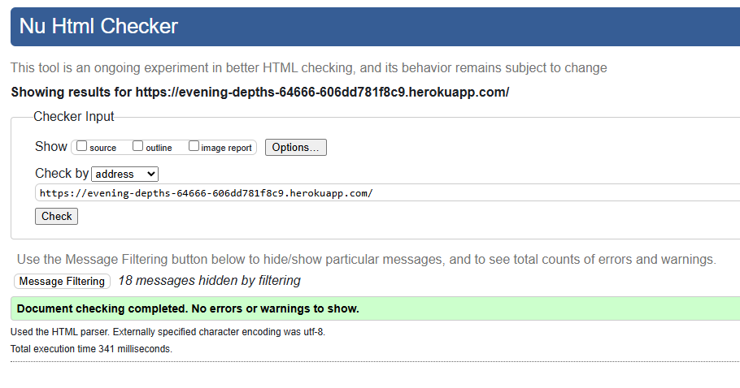
   
   #### CSS Validation
   
   This website's css was validated through W3C's Jigsaw validator at https://jigsaw.w3.org/css-validator/.
   
   When validating the built CSS with the W3C Jigsaw validator, two errors were noted:
   
   - "Unrecognized at-rule @layer"
   - "Unrecognized at-rule @property"
   
   These are not actual errors — they occur because Tailwind CSS uses modern CSS features that Jigsaw’s older validation engine does not yet recognize. All generated styles are valid and fully supported in modern browsers.
   
   Aside from these two warnings, the CSS shows no other errors.
   
   #### Python Validation
   
   Python code quality was validated using **Flake8** and **Black**:
   
   **Flake8 Configuration:**
   - Line length: 88 characters (Black default)
   - Excluded: migrations, venv, node_modules
   - All code passes Flake8 checks with no critical errors
   
   **Black Formatting:**
   - Consistent code formatting across the entire codebase
   - Integrated into development workflow
   
   To run validation:
   ```bash
   flake8 .
   black --check .
   ```
   
   #### JavaScript Validation
   
   The application uses minimal custom JavaScript. The primary JavaScript file is `particle-effect.js`, which creates the animated background effect on the homepage.
   
   **JavaScript Validation:**
   
   The JavaScript code was checked using
   
   The particle effect script:
   - Uses ES6 features (arrow functions, const/let)
   - Includes proper error handling for missing canvas elements
   - Well-documented with JSDoc-style comments
   - No global variable pollution (wrapped in IIFE)
   
   ### Lighthouse Testing
   
   The application was audited using Google Lighthouse to assess performance, accessibility, best practices, and SEO. Performance scored can fluctuate based on network conditions and device capabilities, but the application consistently scores well across all categories.
   
   Here is a screenshot of a Lighthouse audit for the homepage:
   
   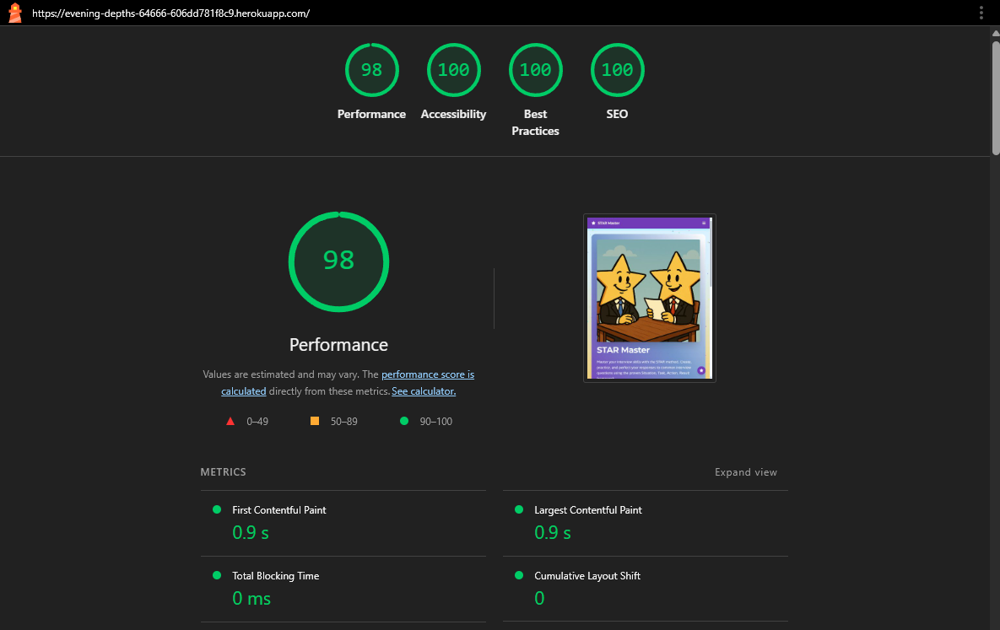
   
   ### Responsiveness Testing
   
   The application was tested across multiple devices and screen sizes:
   
   **Tested Device Sizes:**
   - Desktop: 1920x1080, 1366x768
   - Tablet: 768x1024
   - Mobile: 360x800
   
   **Responsive Features Verified:**
   - ✅ Navigation collapses to hamburger menu on mobile
   - ✅ Forms remain usable on small screens
   - ✅ Tables adapt or scroll on mobile
   - ✅ Images scale appropriately
   - ✅ Text remains readable at all sizes
   - ✅ Touch targets are adequately sized (minimum 44x44px)
   
   ### User Story Testing
   
   User stories were systematically tested to ensure all acceptance criteria were met:
   
   **Example User Stories:**
   
   | User Story                                              | Acceptance Criteria                                                                               | Test Result |
   | ------------------------------------------------------- | ------------------------------------------------------------------------------------------------- | ----------- |
   | As a user, I want to create private interview questions | User can access create form, submit question, see success message, question appears in their list | ✅ Pass      |
   | As a user, I want to create STAR answers                | User can choose STAR format, fill all 4 fields, submit, and view completed answer                 | ✅ Pass      |
   | As a user, I want to browse public questions            | User can view approved public questions without logging in                                        | ✅ Pass      |
   | As an admin, I want to approve public questions         | Admin can view pending questions, approve/deny them, status updates correctly                     | ✅ Pass      |
   | As a user, I want to organize questions with tags       | User can add/remove tags, tags autocomplete, tags filter questions                                | ✅ Pass      |
   
   <!-- TODO: Expand with full user story testing matrix covering all major features -->
</details>

## Use of AI
<details>
   <summary>View AI usage details</summary>
   <br />
   
   AI tools such as GitHub Copilot using the varied selection of models it provided played a critical role throughout the development of the website. Different AI models were used based on the requirements for each task.
   
   ### AI Tools in Code Creation
   
   #### Primary Development Tool: Claude Sonnet 4/4.5
   For the majority of AI-assisted code creation, I used **Claude Sonnet 4/4.5** through GitHub Copilot's agent mode. I found these models to be particularly effective for:
   
   - **Boilerplate Code**: Using commonly used Django syntax for generating views, forms, and models
   - **Multi-File Refactoring**: Managing changes across multiple files while maintaining consistency and avoiding breaking changes
   - **Business Logic Implementation**: Translating business requirements (like the public/private question approval workflow) into working code
   - **Template Architecture**: Building reusable Django template components with proper inheritance and includes
   
   The key to success with this approach was having clear and well-defined requirements written out manually in advance. I took the role of product owner at times, defining the "what" and "why" of each feature, while the AI assisted with the "how". Then I reviewed and refined the AI-generated code to ensure it met the specific needs of the application and had acceptable performance.
   
   #### Prototyping and Experimentation
   **Google AI Studio** was used for quick prototyping and experimentation with JavaScript. This allowed me to create the Star Particle Effect on the homepage by iterating rapidly on code snippets and visual results.
   
   ### AI-Assisted Debugging
   
   AI tools significantly accelerated the debugging process throughout development:
   
   **Failing Tests**
   
   The test suite became very useful as the app grew and the number of moving parts increased. I could safely allow to AI to refactor and add additional functionality, knowing that if something broke, the tests would catch it.
   
   When tests failed, the AI was very effective at reading through the error messages and stack traces, identifying the root cause, and suggesting fixes.
   
   ### Performance and UX Optimization
   
   #### Test Suite Optimization
   This was one of the most impactful AI-assisted optimizations. Through a combination of research and AI assistance:
   
   1. **Research Phase**: I found an article on BuildPulse about speeding up pytest execution
   2. **AI Implementation**: Shared the article with Copilot and asked it to apply relevant optimizations
   3. **Iterative Refinement**: Worked with AI to implement:
      - Shared fixtures to reduce database setup overhead
      - Parallel test execution with `pytest-xdist`
      - Database reuse between test runs with `--reuse-db`
      - SQLite for testing instead of PostgreSQL
   
   **Result**: Test suite execution time dropped from **over 80 seconds to under 9 seconds** - nearly a 10x improvement!
   
   #### Database Query Optimization
   
   - **N+1 Query Problem**: Using django debug toolbar, I identified inefficient database queries on the question list page. I had an intuition that the page was loading too slowly, and by using this toolbar, my suspicions were confirmed. AI suggested using `select_related` and `prefetch_related`, reducing the query time from **2.5 seconds** to under **200 milliseconds**.
   
   ### Automated Unit Test Creation
   
   GitHub Copilot was extensively used to generate unit/integration tests:
   
   #### Test Generation Workflow
   1. **Initial Test Structure**: Copilot generated test class scaffolding based on the view or model being tested
   2. **Test Case Suggestions**: Based on the code, Copilot suggested comprehensive test scenarios I might not have considered
   3. **Assertion Generation**: Copilot wrote appropriate assertions based on expected behavior
   4. **Fixture Creation**: Generated reusable pytest fixtures for common test data
   
   The AI was so eager to write tests, I often had to guide it to avoid writing too many.
   
   #### AI Strengths Observed
   - **Pattern Recognition**: Excellent at applying common patterns (Django views, forms, models)
   - **Boilerplate Generation**: Rapid creation of repetitive code structures
   - **Documentation Reference**: Quick access to framework-specific knowledge
   - **Refactoring Assistance**: Safe, multi-file refactoring with consistency checks
   - **Test Generation**: Comprehensive test coverage suggestions
   
   #### AI Limitations Encountered
   - **Business Logic Complexity**: Required clear explanation of application-specific rules, though when explicitly provided, AI handled them well
   - **Architecture Decisions**: Needed human judgment for high-level design choices
   - **Edge Case Awareness**: Sometimes missed domain-specific edge cases
   - **Frontend CSS Bugs**: required more manual effort as AI was less effective in these areas
</details>

## Development
<details>
   <summary>View development setup details</summary>
   <br />
   
   ### Development Setup
   
   This section provides instructions for setting up a local development environment for the STAR Master application.
   
   #### Prerequisites
   
   Before beginning, ensure you have the following installed:
   
   - **Git** - Version control system to clone the repository
   - **Python 3.13** - Required Python version for this project
   - **Node.js** - Latest LTS version for Tailwind CSS build process
   
   For hosting the database:
   - **NeonDB (Recommended)** - https://neon.com/
   Provides a free tier solution for serverless PostgreSQL databases
   
   
   
   #### Installation Steps
   
   1. **Clone the Repository**
      ```bash
      git clone https://github.com/djpri/star-master-django.git
      cd star-master-django
      ```
   
   2. **Create Virtual Environment**
      ```bash
      python -m venv .venv
      ```
   
   3. **Activate Virtual Environment**
   
      **Windows (PowerShell):**
      ```powershell
      .\.venv\Scripts\Activate.ps1
      ```
   
      **macOS/Linux:**
      ```bash
      source .venv/bin/activate
      ```
   
   4. **Install Python Dependencies**
      ```bash
      pip install -r requirements.txt
      ```
   
   5. **Install Node Dependencies**
      ```bash
      npm install
      ```
   
   6. **Set Up Environment Variables**
   
      Create a `.env` file in the project root:
      ```env
      ENVIRONMENT=development
      DJANGO_SECRET_KEY=your-secret-key-here
      NEON_DB_DEV=neon-db-connection-string-for-development
      NEON_DB_PROD=neon-db-connection-string-for-production
      ```
   
   7. **Run Database Migrations**
   
      **Windows (with Heroku CLI):**
      ```powershell
      heroku local:run python manage.py migrate
      ```
   
      **macOS/Linux:**
      ```bash
      heroku local:run python3 manage.py migrate
      ```
   
   8. **Create Superuser (Admin Account)**
      ```bash
      heroku local:run python3 manage.py createsuperuser
      ```
   
   9. **Load Sample Data (Optional)**
      ```bash
      python manage.py loaddata questions/fixtures/sample_data.json
      ```
   
      **⚠️ Warning:** If the fixture contains explicit primary keys, it may override existing data in your database.
   
   
   #### Running the Development Server
   
   The application requires two processes during development:
   
   10. **Django Development Server**
   
      ```shell
       heroku local:run python manage.py runserver
      ```
   
   11. **Tailwind CSS Watch Mode** (in a separate terminal)
      ```bash
      npm run dev
      ```
   
   The application will be available at `http://localhost:8000`
   
   ##### VS Code
   
   If running in VS Code you can use the provided `launch.json` configuration to start both processes with debugging support.
   
   Click 'Run and Debug' in the sidebar, select 'Django & Tailwind', and click the green play button.
   
   #### Running Tests
   
   **Run all tests:**
   ```bash
   pytest
   ```
   **Run specific test file (example):**
   ```bash
   pytest questions/tests/views/test_question_list_view.py
   ```
   
   **Note:** Tests use SQLite database by default, so no additional setup is required. Environment variables are not needed for test execution.
   
   ### Database Configuration
   
   #### Development Database Options
   
   **SQLite (Default):**
   - No additional setup required
   - Suitable for development and testing
   - Database file: `db.sqlite3` in project root
   
   **PostgreSQL (Recommended for Production-Like Development):**
   1. Install PostgreSQL locally
   2. Create a database: `createdb star_master_dev`
   3. Update `.env` with `DATABASE_URL`
   4. Run migrations
   
   #### Database Migrations
   
   **Create new migrations after model changes:**
   ```bash
   python manage.py makemigrations
   ```
   
   **Apply migrations:**
   ```bash
   python manage.py migrate
   ```
   
   **View migration status:**
   ```bash
   python manage.py showmigrations
   ```
   
   ### Important Development Notes
   
   #### PowerShell Virtual Environment Activation
   
   When using PowerShell, you must activate the virtual environment before running Python commands. The virtual environment does NOT auto-activate in new terminal sessions.
   
   #### Using Heroku Local
   
   The `heroku local:run` command is used to run Python management commands with environment variables loaded from the `.env` file:
   
   ```powershell
   heroku local:run python manage.py <command>
   ```
   
   **Exception:** Pytest commands do not require environment variables, so run them directly:
   ```bash
   pytest
   ```
   
   #### Development Server Management
   
   During development, I typically run the Django development server manually and keep it running while making changes. The `django-browser-reload` package automatically refreshes the browser when template or static files change.
   
   ### Static Files Management
   
   **During Development:**
   Static files are served by Django's development server with WhiteNoise middleware.
   
   **Collecting Static Files:**
   ```bash
   python manage.py collectstatic
   ```
   
   This command collects all static files into the `staticfiles/` directory for production deployment.
   
   **Static File Structure:**
   ```
   static/                       # Project-level static files
   theme/static_src/             # Tailwind CSS source files
   staticfiles/                  # Collected static files (production)
   ```
   
   ### Additional Development Commands
   
   Search vectors are normally updated automatically when items are added through the application. However, if you load data via fixtures or make bulk changes, you may need to update them manually.
   
   **Update search vectors (for full-text search):**
   ```bash
   python manage.py update_search_vectors
   ```
</details>

## Deployment
<details>
   <summary>View deployment details</summary>
   <br />
   
   ### Cloud Platform
   
   STAR Master is deployed on **[Heroku](https://www.heroku.com/)**, a cloud platform that allows developers to build, run, and operate applications entirely in the cloud. Heroku provides:
   
   - Easy deployment via Git
   - Automatic HTTPS for all applications
   - Scalable infrastructure
   - Add-on ecosystem for databases, monitoring, and more
   
   ### Database
   
   The production database is a **PostgreSQL** database hosted on a server provided by Code Institute. PostgreSQL was chosen for:
   
   - Robust full-text search capabilities
   - Advanced indexing options (GIN indexes)
   - ACID compliance and data integrity
   - Strong Django ORM support
   
   ### Environment Variables
   
   The following environment variables must be configured in Heroku:
   
   | Variable            | Description                                                                                         | Required |
   | ------------------- | --------------------------------------------------------------------------------------------------- | -------- |
   | `DATABASE_URL`      | PostgreSQL connection string (automatically set if using Heroku Postgres add-on)                    | Yes      |
   | `DJANGO_SECRET_KEY` | Secret key for Django application (must be unique and secure)                                       | Yes      |
   | `ENVIRONMENT`       | Set to `development` for development mode. If not set, app runs in production mode with DEBUG=False | No       |
   | `NEON_DB_PROD`      | Production database URL (alternative to DATABASE_URL)                                               | Yes*     |  | No |
   
   **Note:** Either `DATABASE_URL` or `NEON_DB_PROD` must be set for production deployment.
   
   ### Deployment Process
   
   #### Initial Setup
   
   1. **Create Heroku App**
      ```bash
      heroku create your-app-name
      ```
   
   2. **Configure Buildpacks**
   
      The application uses two buildpacks in the following order:
      - Node.js (for Tailwind CSS compilation)
      - Python (for Django application)
   
      ```bash
      heroku buildpacks:add --index 1 heroku/nodejs
      heroku buildpacks:add --index 2 heroku/python
      ```
   
      **⚠️ Important:** The order is critical. Node.js must run first to compile Tailwind CSS before Python collects static files.
   
   3. **Set Environment Variables**
      ```bash
      heroku config:set DJANGO_SECRET_KEY="your-very-long-secret-key-here"
      heroku config:set NEON_DB_PROD="your-database-url"
      ```
   
      **Generating a Secure Secret Key:**
      ```python
      python -c "import secrets; print(secrets.token_urlsafe(64))"
      ```
   
   4. **Add PostgreSQL Database** (if not using external database)
      ```bash
      heroku addons:create heroku-postgresql:essential-0
      ```
   
   #### Deploying the Application
   
   5. **Commit Your Changes**
      ```bash
      git add .
      git commit -m "Prepare for deployment"
      ```
   
   6. **Push to Heroku**
      ```bash
      git push heroku main
      ```
   
      Or if using a different branch:
      ```bash
      git push heroku your-branch:main
      ```
   
   7. **Run Database Migrations**
      ```bash
      heroku run python manage.py migrate
      ```
   
   8. **Create Admin User**
      ```bash
      heroku run python manage.py createsuperuser
      ```
   
   9. **Collect Static Files** (usually automatic via `heroku-postbuild`)
      ```bash
      heroku run python manage.py collectstatic --noinput
      ```
   
   #### Automatic Deployment
   
   The `package.json` includes a `heroku-postbuild` script that automatically runs when deploying to Heroku:
   
   ```json
   "heroku-postbuild": "npm run build"
   ```
   
   This ensures Tailwind CSS is compiled before the application starts.
   
   The `Procfile` defines how Heroku should run the application:
   
   ```
   web: gunicorn config.wsgi
   ```
   
   ### Security in Deployment
   
   #### Environment Variable Management
   
   All sensitive information is managed via environment variables:
   
   - **No hardcoded secrets** in the source code
   - `.env` file for local development (excluded from Git via `.gitignore`)
   - Heroku Config Vars for production deployment
   - Secret keys rotated after any potential exposure
   
   #### Debug Mode Configuration
   
   The application includes the following logic to prevent DEBUG mode in production:
   
   ```python
   DEBUG = os.environ.get("ENVIRONMENT") == "development"
   ```
   This is a relatively safe approach because the `ENVIRONMENT` variable has to be deliberately set to `development` to enable DEBUG mode. By default, the application runs in production mode with `DEBUG=False`.
   
   #### HTTPS Enforcement
   
   The application enforces HTTPS in production:
   
   ```python
   if IS_HEROKU_APP:
       SECURE_SSL_REDIRECT = True
   ```
   
   This ensures all traffic is encrypted, protecting user data and session information.
   
   #### Leaked ENV file Issue (Now Resolved)
   
   During early development, sensitive information was accidentally committed to the repository. To remediate this:
   
   - **Set the public repository to private temporarily** as I worked through the cleanup
   
   - **Used BFG Repo Cleaner** to remove sensitive data from entire Git history
   
   - **Rotated all compromised credentials:**
      - Generated new Django secret key
      - Updated database credentials
      - Regenerated any API keys
   
   - **Verified removal:**
      ```bash
      git log --all --full-history -- "*sensitive-file*"
      ```
   
   - **Force-pushed clean history:**
      ```bash
      git push --force
      ```
   
   **Lesson Learned:** Always add sensitive files to `.gitignore` before the first commit. Use environment variables from the start.
</details>

## Credits
<details>
   <summary>View credits and acknowledgements</summary>
   <br />
   
   ### Heroku's Django Template
   
   https://github.com/heroku/python-getting-started
   
   This repository provided a solid foundation for creating a Django application optimized for deployment on Heroku. The settings.py configuration was clearly commented to explain why certain settings were added, particularly ones specific to using Heroku.
   
   ### Articles and Resources
   
   #### Performance Optimization
   - **[How to Speed Up Pytest](https://buildpulse.io/blog/how-to-speed-up-pytest)** - BuildPulse
   
     This article played a key role in optimizing the test suite to dramatically reduce the time taken to run all tests.
   
   #### CSS Techniques
   - **[The Fixed Background Attachment Hack](https://css-tricks.com/the-fixed-background-attachment-hack/)** - CSS-Tricks
   
     This article inspired the implementation of the fixed gradient background that remains stationary while users scroll through the page. The technique creates a subtle but effective visual polish that enhances the overall user experience without being distracting.
   
   ### AI Tools
   
   - **[GitHub Copilot](https://github.com/features/copilot)** - AI pair programmer
     - Claude Sonnet 4/4.5 - Primary model for agent-based development tasks
     - GPT-5-Codex - Alternative model for specific use cases
     - Multiple premium models for specialized tasks
   
   - **[ChatGPT](https://chat.openai.com/)** - Additional AI assistance for debugging and problem-solving
   
   - **[Google AI Studio](https://ai.google.dev/studio)** - Prototyping and experimentation
   
   ### Code Institute
   
   - **[Code Institute](https://codeinstitute.net/)** - Online coding bootcamp
     - Provided the foundational knowledge and skills to build this project
     - Curriculum covered Django, Python, HTML, CSS, JavaScript, PostgreSQL, Git, GitHub, Agile methodology, and more
     - Mentorship and support throughout the learning journey, through a combination of daily standup/standdown meetings, coading coach sessions, and the Code Institute Discord community
</details>
